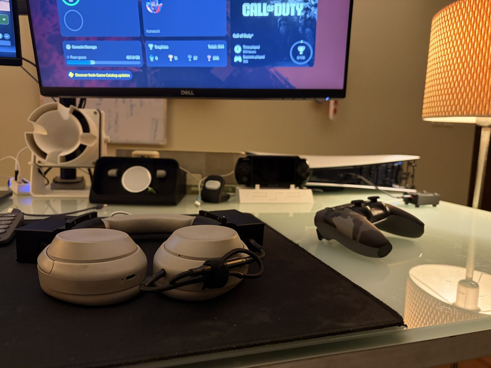
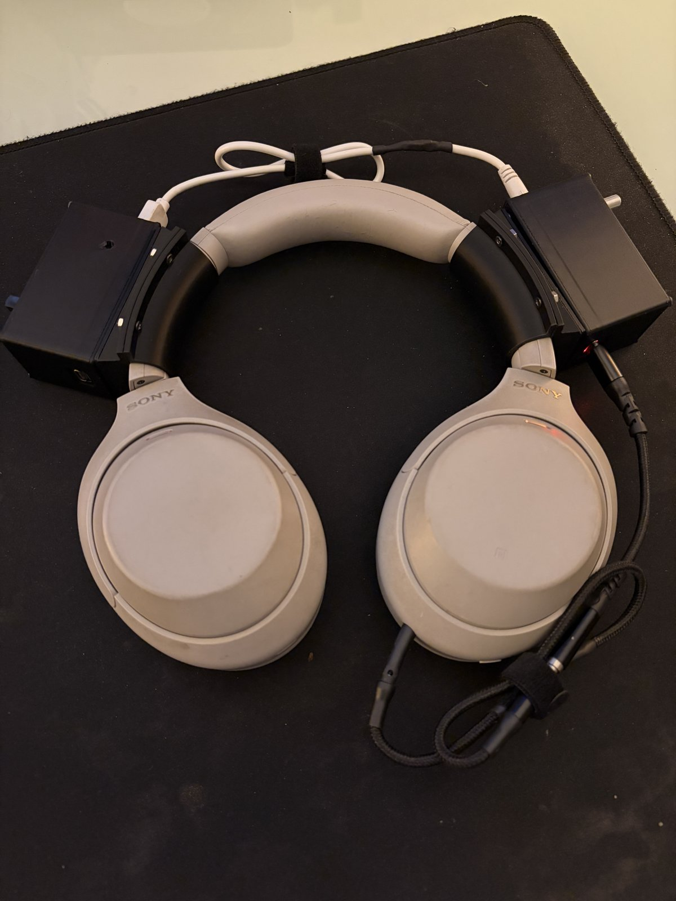
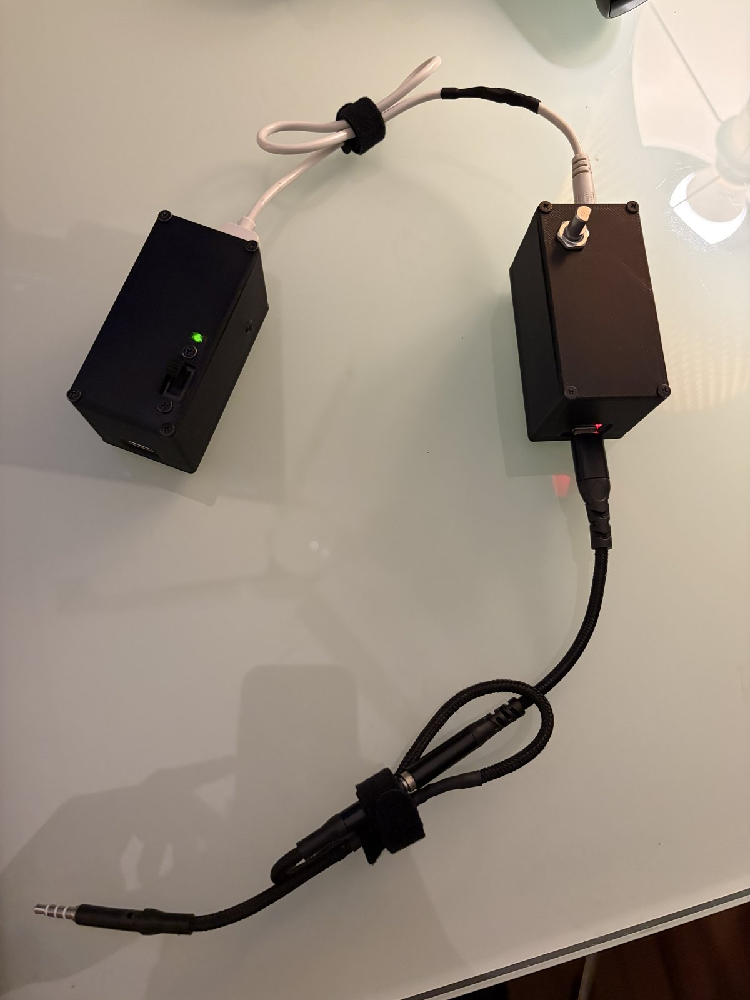
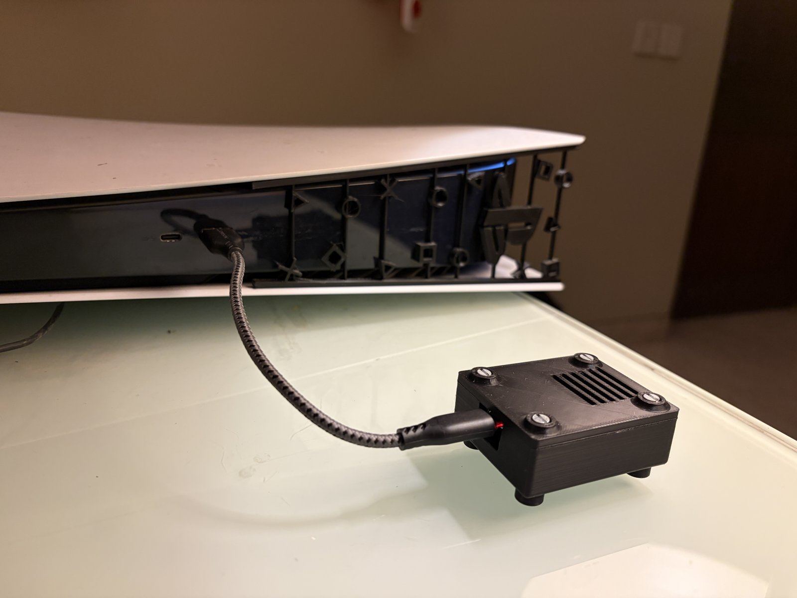
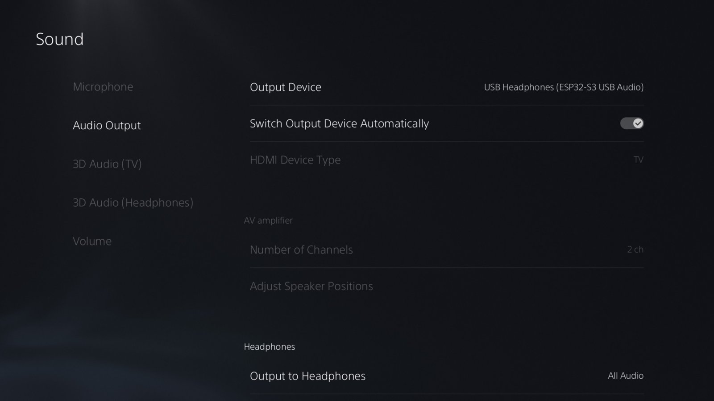

# PS5 Wireless Headphones: any 3.5 mm headphone, ~20 ms

Make **any headphone with a 3.5 mm input** (Sony WH-1000XM4/XM5, Bose, studio headphones) into a **low-latency wireless headset for the PS5**. You need two ESP32-S3 boards, a cheap USB audio dongle and a few hobby modules.

The PS5 has no Bluetooth audio, and Bluetooth dongles add 150–250 ms with most headphones. This link doesn't use Bluetooth. It sends uncompressed 48 kHz / 16-bit stereo over ESP-NOW to the headphones' wired input, and the headphones stay in wired mode, so ANC still works.



```
PS5 ──USB──▶ [ESP32-S3 transmitter] ~~ ESP-NOW, 2.4 GHz ~~▶ [ESP32-S3 receiver] ──USB──▶ USB-to-3.5 mm dongle ──▶ headphones
             appears as "USB Headphones"                     on the headband, battery powered
```

## Highlights

- **Plug and play on the PS5.** The transmitter is a standard USB Audio Class 1 device. The only setting is choosing it as the output device.
- **About 20 ms end to end.** This is calculated from measured buffer levels; see [Latency](#latency). In testing there was no visible lip-sync offset.
- **Uncompressed audio.** It sends raw 16-bit PCM, not a lossy codec. Each packet also carries a compressed copy of the previous frame, so a single lost packet is repaired without an audible gap.
- **Volume knob with boost.** A rotary encoder on the headband sets the dongle volume. Past 100 % it adds up to +12 dB of digital gain with a soft limiter. The PS5's USB output is quiet, so the boost is useful.
- **All headphone features still work.** ANC, EQ and battery behave as normal because the headphones run in wired mode.
- **Install from the browser** with the **[web flasher](https://k-m.github.io/ps5-wireless-headphones/)** (Chrome or Edge).

| | |
|---|---|
|  |  |
| Two modules on the headband, one on each side | Power module (left) and receiver with volume knob (right) |
|  |  |
| Transmitter in the PS5 front port | PS5: *Output Device → USB Headphones (ESP32-S3 USB Audio)* |

## Parts

| Part | Qty | Notes |
|---|---|---|
| Waveshare ESP32-S3-Pico | 1 | Transmitter that plugs into the PS5. Any ESP32-S3 board with native USB should work. |
| Waveshare ESP32-S3-Nano | 1 | Receiver (USB host). |
| USB-to-3.5 mm audio dongle | 1 | Must support 48 kHz 16-bit stereo; most cheap dongles do. Tested with a Generalplus `1b3f:2008`. |
| USB OTG adapter | 1 | Connects the Nano's USB-C port to the dongle. |
| Rotary encoder (EC11/KY-040 type) | 1 | Volume control. A push switch isn't needed. |
| 1S LiPo, 500 mAh | 1 | About 1.5–2 h of use (estimated). A bigger cell gives proportionally longer use. |
| HW-107 (TP4056 with protection) | 1 | Charger. Change R_PROG (R3, marked `122`) to 3 kΩ (`302`) for a 400 mA charge. The stock 1 A is too high for 500 mAh. |
| HW-106 boost module | 1 | Takes the LiPo voltage up to 5 V. The receiver browns out below about 4.5 V. |
| DPDT slide switch | 1 | Power on/off; also routes USB-C power to the charger only when the unit is off. |
| USB-C breakout (power only) | 1 | Charging port. |
| Green LED + 1 kΩ resistor | 1 | Power indicator. |
| 470 µF capacitor | 1 | Across VBUS and GND at the Nano. |
| 100–220 µF capacitor | 1 | Across the HW-106 input. |
| Magnets, M2–M2.5 screws, 3D-printed cases | n/a | STLs and Fusion 360 sources are in [`hardware/`](hardware/). |

## Wiring

The build has two modules on the headband, joined by a short USB cable that carries 5 V.

**Power module**

```
LiPo ───────────────▶ HW-107  B+ / B−

DPDT pole 1:  common ◀── HW-107 OUT+
              ON     ──▶ HW-106 IN+    ──┬── green LED ── 1 kΩ ── GND
                                         └── 100–220 µF to GND
DPDT pole 2:  common ──▶ HW-107 IN+
              OFF    ◀── USB-C breakout VBUS

HW-106 OUT+ / OUT− ──▶ USB cable ──▶ receiver module 5 V / GND
All grounds common.
```

Switch ON: the battery powers the boost and the LED lights. Switch OFF: the boost is disconnected and USB-C charges the battery. Because charging and running never happen at the same time, you don't need a load-sharing circuit.

**Receiver module**

```
5 V from power module ──▶ Nano VBUS pin    (NOT VIN)
GND                   ──▶ Nano GND
470 µF across VBUS–GND at the Nano

Encoder A ──▶ D5 (GPIO8)
Encoder B ──▶ D6 (GPIO9)
Encoder C ──▶ GND           (internal pull-ups are used; no resistors)

Nano USB-C ──OTG adapter──▶ USB audio dongle ──3.5 mm──▶ headphones
```

The Nano's VBUS pin connects directly to its USB-C port, so feeding VBUS is what powers the dongle. If you feed VIN instead, the dongle gets no power.

The transmitter needs no wiring. Plug it into a PS5 USB port.

## Install

1. Open the **[web flasher](https://k-m.github.io/ps5-wireless-headphones/)** in Chrome or Edge.
2. Pick the Wi-Fi channel. The default is 13, and both boards must use the same one.
3. Flash both boards:
   - **Transmitter:** hold BOOT while you plug it in.
   - **Receiver:** bridge B1 to GND, then tap RESET.
4. Plug the transmitter into the PS5, then go to **Settings → Sound → Audio Output → Output Device → USB Headphones**.
5. Switch the receiver on and turn on the headphones. Set the PS5 volume to maximum and use the knob for volume.

If you'd rather use the command line, prebuilt images are in [`docs/firmware/`](docs/firmware/). Flash the `.bin` at offset `0x0`:

```
esptool.py --chip esp32s3 write_flash 0x0 <file>.bin
```

## Volume knob

| Level | Effect |
|---|---|
| 0–100 | Dongle hardware volume, 2 % per detent |
| 101–124 | Digital boost, +0.5 dB per detent, up to +12 dB, with a soft limiter so peaks don't clip |
| Limits | A short tick in the headphones when you hit 0 or maximum |

The level is saved 2 s after the last change and restored at power-up. The default is 100 (no boost). Tested on the build shown here.

## Latency

These figures are calculated per stage from the receiver's logged buffer levels. They are not a single end-to-end measurement.

| Stage | Time |
|---|---|
| Assemble a 3 ms audio frame on the transmitter | ≤ 3 ms |
| Radio send (11 Mbit/s DSSS, measured) | ~1.4 ms |
| Jitter buffer (4 frames, measured average) | ~11.7 ms |
| USB host queue to the dongle | ~2–4 ms |
| Dongle DAC | ~1 ms |
| **Total** | **≈ 20 ms** |

For comparison, Bluetooth headphones over a USB dongle add about 150–250 ms. Commercial wireless IEM kits advertise about 5–12 ms and cost about ₹6,000 / $70–140 or more.

An end-to-end measurement hasn't been done yet. A measurement kit is included in [`tools/latency/`](tools/latency/); PRs with results are welcome.

## How it works

- **Transmitter:** a TinyUSB UAC1 device (44.1/48 kHz, adaptive isochronous). If the input is 44.1 kHz it is resampled to 48 kHz. The audio is cut into 3 ms frames and broadcast over ESP-NOW v2 at 11 Mbit/s DSSS. In testing, DSSS was more reliable than OFDM rates for 740-byte packets.
  - The send queue holds one frame, the newest. A deeper queue only delivered stale frames late.
- **Packet (740 bytes):** a 12-byte header, 576 bytes of PCM (3 ms), and a 152-byte IMA-ADPCM copy of the previous frame.
- **Receiver:** a 4-frame jitter buffer.
  - Lost frames are rebuilt from the backup copy. Longer gaps fade out and back in.
  - Clock drift is corrected by resampling a whole frame by ±1 sample (144 → 143/145) with a ±1.5 ms deadband, which is inaudible.
- **USB host:** Espressif's `usb_host_uac` drives the dongle. The periodic-OUT FIFO bias is enabled so that 192-byte isochronous packets fit.

More detail: [troubleshooting](docs/troubleshooting.md), [building from source](docs/building.md), [hardware](hardware/).

## Compatibility

- **PS5:** tested.
- **PC/Mac and other USB-audio hosts:** expected to work, since it is a standard UAC1 device. Not tested.
- **Xbox:** not supported. Xbox doesn't accept generic USB audio devices.

## Known limitations

- **No microphone.** The XM4 doesn't carry its mic over the 3.5 mm cable. An analog mic on the receiver was tried and dropped: the ESP32's own radio bursts couple into its ADC at 166 Hz. Use the DualSense mic for chat.
- **Shares 2.4 GHz.** On a busy Wi-Fi channel you'll hear occasional ticks. Channel 1 was unusable in testing and channel 13 was clean. Change channel in the flasher.
- **Battery:** about 1.5–2 h on 500 mAh (estimated, not measured). It can't charge while switched on, and there is no low-battery warning.

## Roadmap

- [ ] Measured end-to-end latency and battery runtime
- [ ] Automatic channel selection
- [ ] Mic return path using an I2S MEMS mic (avoids the ADC noise problem)
- [ ] Compact receiver: XIAO ESP32-S3 + I2S DAC instead of the Nano + USB dongle

Contributions are welcome.

## License

MIT for this project's code. Bundled third-party components keep their own licenses: TinyUSB (MIT), Espressif `usb_host_uac` (Apache-2.0) and Espressif `cmake_utilities` (Apache-2.0).

This project is not affiliated with Sony Interactive Entertainment. "PS5" is used only to describe compatibility.
