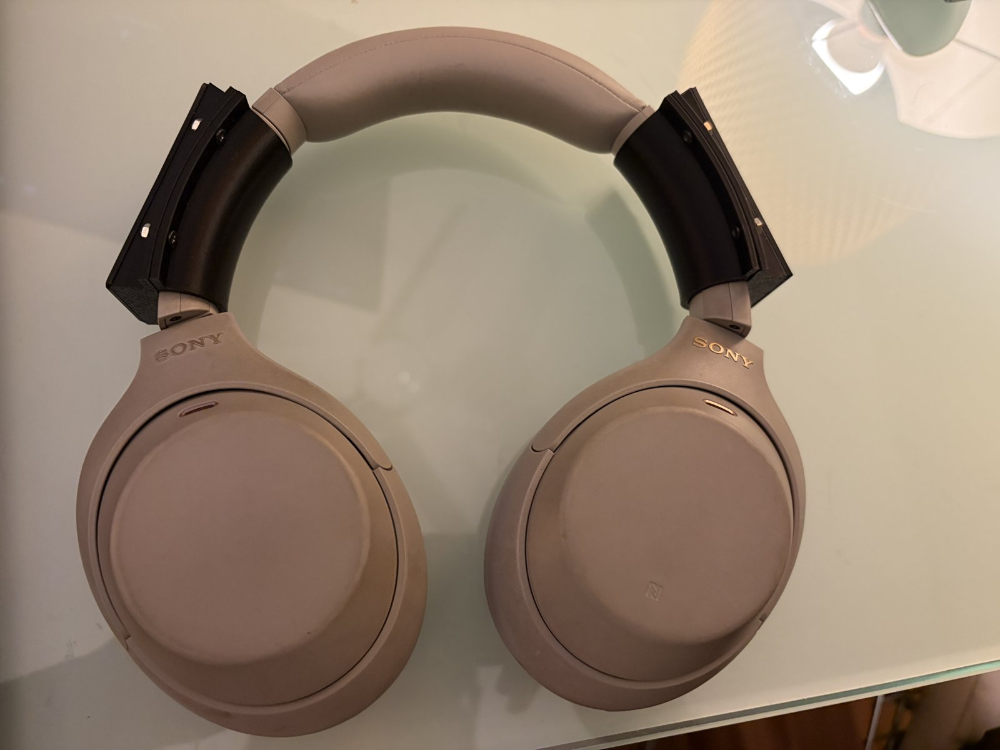
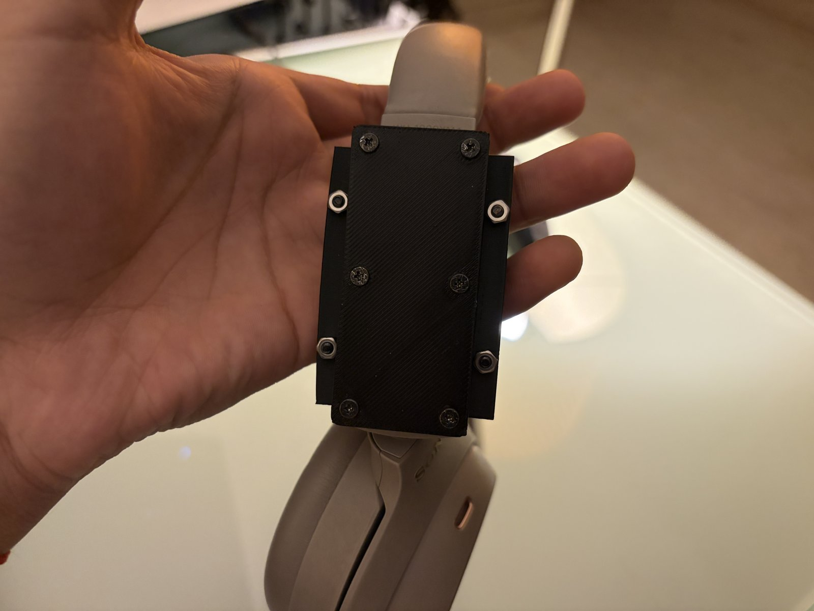
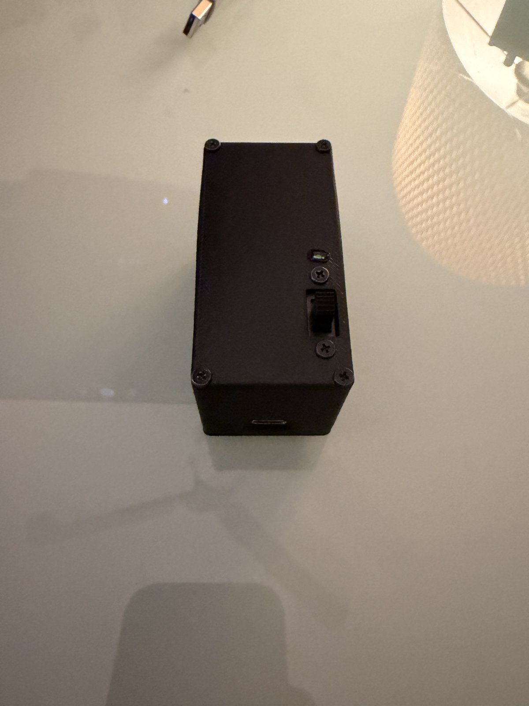
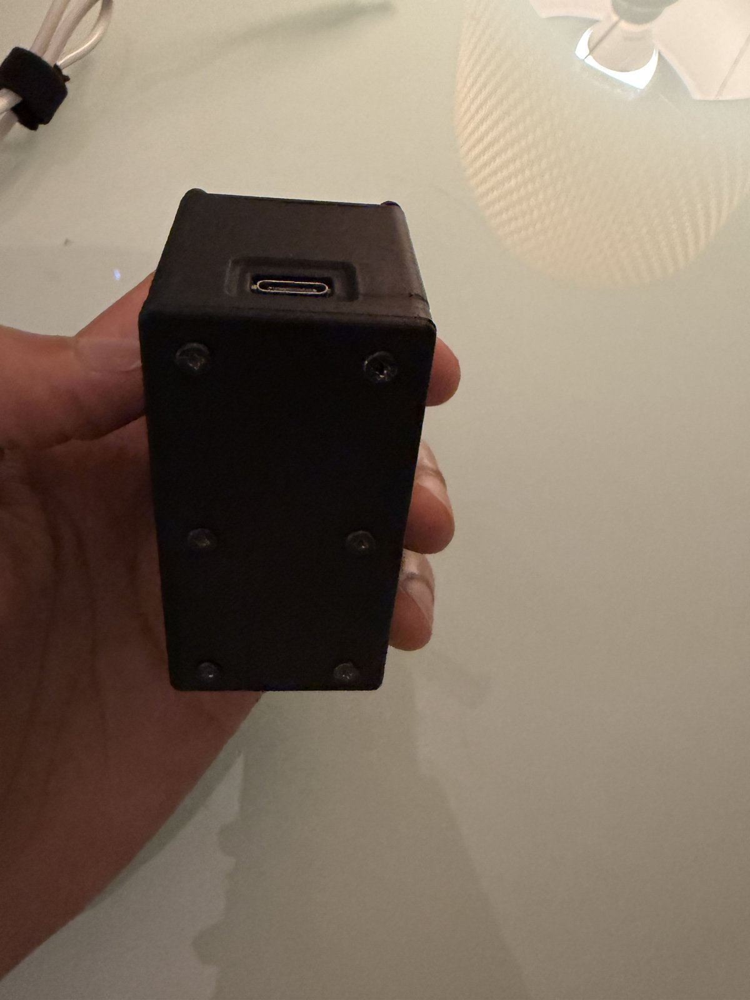
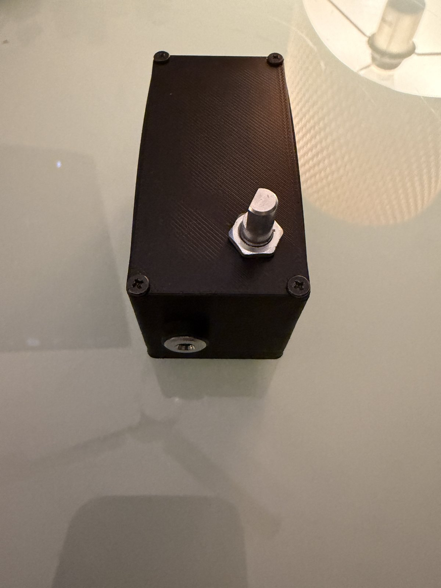
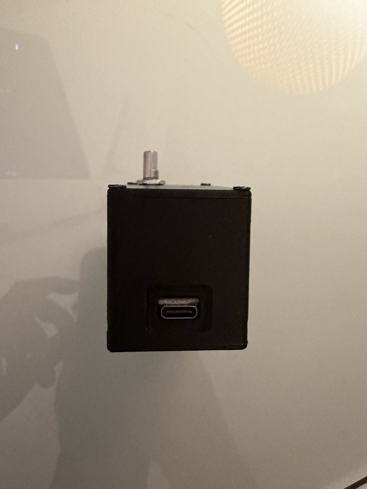
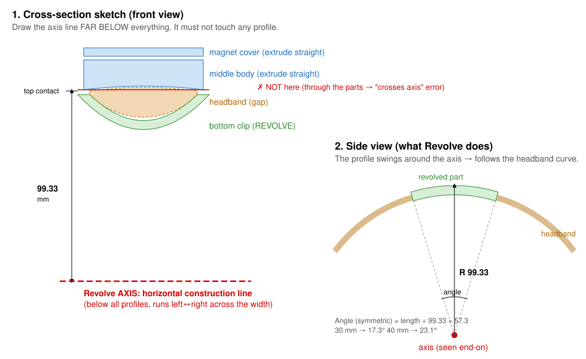

# Hardware

STL files are not published yet. The design is simple enough to recreate. This page records the dimensions and the method.

## Layout

There are two printed boxes, one on each side of the headband. Each box sits on a curved mount that clips to the band and holds it by magnets.

| Module | Contents | Controls / ports |
|---|---|---|
| Power | LiPo, HW-107 charger, HW-106 boost, DPDT switch, LED, USB-C breakout | LED window, slide switch, USB-C (charging), 5 V out to the receiver |
| Receiver | ESP32-S3-Nano, rotary encoder, USB audio dongle | Volume knob, 3.5 mm out, USB |

Splitting the build like this balances the weight on the headband and keeps the boost converter away from the radio and audio parts.

| | | |
|---|---|---|
|  |  |  |
| Curved mounts, modules removed | Magnet mount plate | Power module: LED, switch, USB-C |
|  |  |  |
| Power module lid, 6 × M2 screws | Receiver: volume knob and 3.5 mm | Module end, USB-C |

## Curved headband mount (Fusion 360)

The WH-1000XM4 headband's top surface has a radius of about **99.33 mm**. The mount is a 2D cross-section revolved around an axis at that radius:

1. Sketch the cross-section in the front plane: the magnet cover, the body, and the clip that wraps under the band.
2. Draw a horizontal construction line **99.33 mm below the top contact point**, outside every profile. If the axis touches a profile, Fusion reports that it "crosses the axis".
3. Revolve the profile around that line by **angle = length ÷ 99.33 × 57.3°**. For example, a 60 mm part needs 34.61°. Use the same angle for every part of the mount so they line up.

To measure your own headband's radius, trace its curve on paper. Then measure a chord *c* and the height *h* of the arc above the chord, and use **R = c²/(8h) + h/2**.

## Notes

- **Screws:** M2–M2.5 self-tapping into printed pilot holes. Use 1.6 mm pilot holes for M2 and 2.0 mm for M2.5.
- **Magnets:** keep them at least about 1 cm from the ESP32's antenna and the boost converter's inductor. If there's no room, use a thin steel plate as a shield behind the magnet.
- **Capacitors:** fit the 470 µF capacitor at the Nano's VBUS pin, not at the boost output. The boost and the Nano are in different modules, so the capacitor must sit at the load end of the cable.
